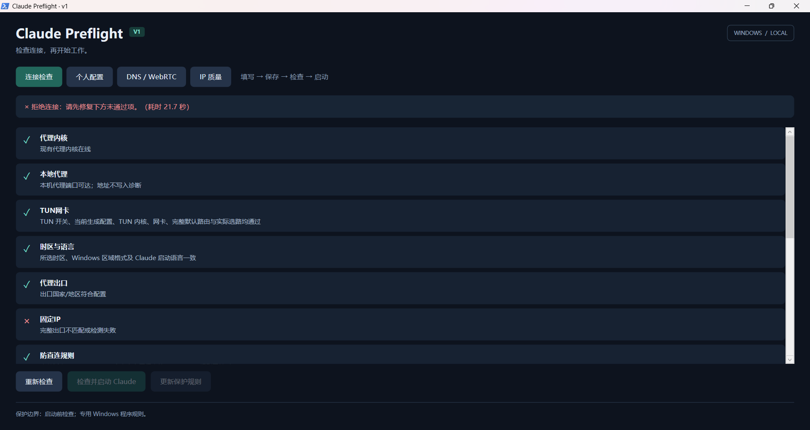
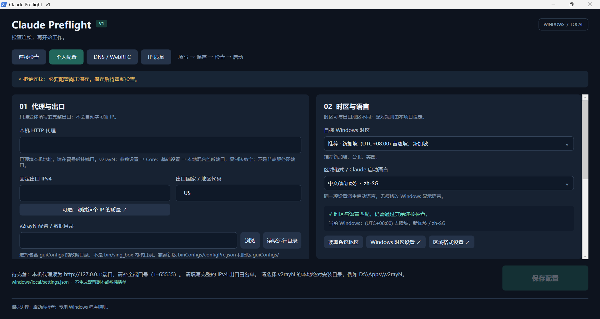
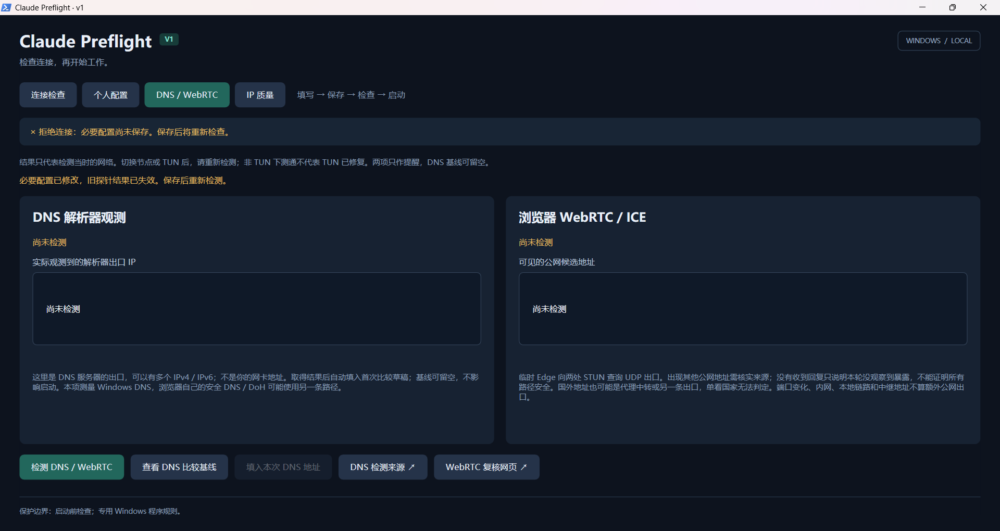
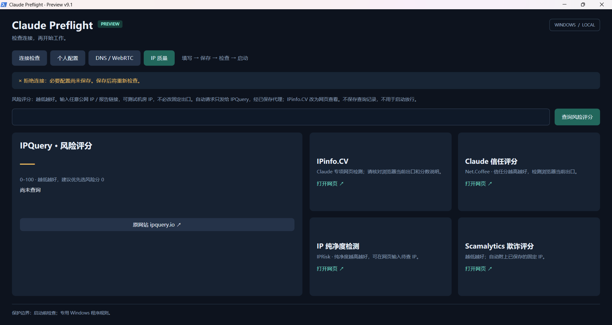
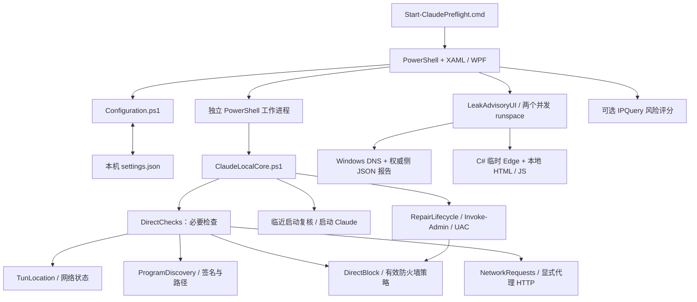

# Claude Preflight · Windows v1

**检查连接，再开始工作。**

**极致轻量化、开箱即用！！！**

**🟢强烈推荐您每次运行Claude PC端前打开此检测工具，检测通常只需10-20s**

Claude Preflight 为 Claude Windows 桌面端提供图形化的启动前检查，并通过 Windows 防火墙限制已识别的 Claude 专用程序直连外网。把本机代理、固定出口和地区设置集中保存后，每次使用都能在一个窗口里核对当前状态。

代理是否真正接管了流量、出口是否仍是选定节点、TUN 是否生效、DNS 从何处解析，这些信息分散在不同软件和系统页面。Claude Preflight 将它们集中展示：**启动前核验必要条件，未通过则拒绝启动；辅助观测分别返回，供用户核查。**

适合已经配置好 **v2rayN / sing-box TUN、本机 HTTP 代理和固定 IPv4 出口**，希望统一检查和启动 Claude 的用户。


## 功能

| 功能 | 说明 |
|---|---|
| 出口 IP / 地区核验 | Cloudflare 与 ipify 交叉核对完整固定 IPv4，另核对出口国家 / 地区 |
| 时区 / 区域格式 / 启动语言 | 读取 Windows 实际设置，与保存项及地区语言配对规则核对；时区可与出口国家不同 |
| TUN 状态 | 六层核对：v2rayN 开关、生成配置、内核进程、网卡、默认路由完整性、Windows 实际选路 |
| 程序防直连 | 为核验身份和签名的 Claude 专用 exe 建立非回环 IPv4 / IPv6 阻断规则，保留本机代理路径 |
| 升级后补规则 | 重新发现官方程序路径，验证签名后更新保护范围 |
| DNS / WebRTC 观测 | 观察 Windows 解析器出口与临时 Edge 的 UDP 公网候选；并发执行，各约 30 秒预算，仅作提醒 |
| IP 质量参考 | 按需查询 IPQuery 风险分与机房等属性，另提供四个网页检测入口 |
| 单文件配置 | 在图形界面填写、选择和保存；个人参数集中在 `windows/local/settings.json` |

## 工具示例图片

1.连接检查




2.个人配置




3.DNS/WebRTC




4.IP质量




## 为什么做Claude PC端工具

1.因为cc相关同类开源项目已经有成熟解决方案
2.Claude PC端对于codex转Claude用户比较友好
3.本项目提供轻量化、图形化操作界面，简单易上手
4.Claude PC端触发风控概率较低，且已经内置Claude code，新账号初期直接使用cli属于较高风险的使用方式，先使用桌面端等账号形成正常使用记录后有需要可以再换到cli


## 运行要求

| 组件 | 要求 |
|---|---|
| 系统 | Windows 10 / 11；使用系统 Windows PowerShell 5.1、.NET Framework / WPF 和网络管理模块 |
| 代理 | 已有可用的 v2rayN、本机回环 HTTP 代理、sing-box TUN 和固定公网 IPv4 |
| Claude | 已安装的官方 Windows 桌面端；程序发现按官方应用包身份、目录布局和 Anthropic 签名核验 |
| 防火墙 | Windows 防火墙及 BFE / MpsSvc 服务可用；应用和撤销规则时需要管理员授权 |
| Edge | WebRTC 辅助观测使用已安装的 Microsoft Edge |
| 系统 curl | 规则应用流程使用 Windows 自带 `curl.exe` 做连接对照测试 |

普通用户**无需安装 Python、Node.js、npm、.NET SDK 或 Visual Studio**。工具解压后由 CMD 启动 PowerShell 图形界面，C# 辅助代码使用系统能力加载，JavaScript 在 Edge 内执行。

当前适配范围为上述 Windows 组合；其他代理客户端、特殊 Claude 安装布局、精简系统和 ARM 设备需要另行验证。

## 快速开始

### 1. 解压并打开

解压文件夹并打开，双击：

```text
Start-ClaudePreflight.cmd
```

### 2. 保存个人配置

打开“个人配置”，填写以下项目，再点击“保存配置”。

| 项目          | 怎么填                                                                      |
| ----------- | ------------------------------------------------------------------------ |
| 本机 HTTP 代理  | `http://127.0.0.1:端口`。v2rayN 中可查看“参数设置 → Core 基础设置 → 本地混合监听端口”；这里填本地监听端口 |
| 固定出口 IPv4   | **填你明确要固定使用的完整公网 IPv4**，检查会向两个出口接口核对，不会自动信任首次检测结果                        |
| 出口国家 / 地区   | 固定出口对应的两个大写字母代码，例如 `US`                                                  |
| v2rayN 数据目录 | 选择包含 `guiConfigs` 的数据目录                                                  |
| TUN 网卡名称    | 填当前 sing-box TUN 网卡的精确名称                                                 |
| Windows 时区  | 选择要核对的系统时区，系统实际设置需要相符                                                    |
| 区域格式 / 启动语言 | 按界面选择；工具核对 Windows 区域格式，并以同一选项设置 Claude 启动语言                             |
| DNS 比较基线    | **可留空**。获得有效 DNS 观测后会自动填入首次草稿，保存后用于后续比较                                  |

唯一的个人配置文件是 `windows/local/settings.json`，首次保存时创建。公开包中的 `settings.example.json` 是空模板，保持原样即可。

### 3. 应用程序防直连规则

先保存工作，完全退出 Claude / Cowork，然后点击“更新保护规则”，或运行：

```text
Apply-ClaudeNoDirect.cmd
```

使用保存配置的同一 Windows 账号，按提示完成管理员授权。工具会核验官方程序、做网络对照测试，再应用规则；完成后回到界面重新检查。

### 4. 检查并启动

保持选定节点与 TUN 运行，点击“重新检查”。必要项通过后，点击“检查并启动 Claude”。该按钮会重新检查，并在创建进程前复核关键状态，再传入代理和语言参数。

DNS / WebRTC 可以继续在后台返回结果，不必等它们完成才启动。切换节点、代理设置或 TUN 状态后，应重新检查。

## 检查结果怎么理解

### 必要条件

| 检查项 | 核对内容 |
|---|---|
| 代理内核 | xray / sing-box 进程 |
| 本地代理 | 保存的回环端口可连接 |
| TUN | v2rayN 开关、生成配置、sing-box 进程、指定网卡、默认路由与两处实际选路 |
| 时区与语言 | 系统时区、区域格式与保存项及配对策略一致 |
| 代理出口 | Cloudflare 返回的国家 / 地区符合配置 |
| 固定 IP | Cloudflare 与 ipify 均匹配保存的完整 IPv4 |
| 防直连规则 | 当前专用 exe 的有效规则、服务与防火墙配置文件状态 |
| API 连接 | 经代理访问 Anthropic API；HTTP 200 / 401 作为连接证据，请求不带账号凭据 |
| Claude 安装 | 能定位受支持的官方桌面端 |
| 启动状态 | Claude 主进程已退出，可创建带新参数的进程 |

必要项失败、缺失或无法确认时拒绝启动。地区配对和固定出口是本工具的使用策略。

### DNS / WebRTC：辅助观测

两项只需有效的本机代理配置即可发起，不要求先通过固定出口或 TUN 检查。

**DNS**：经代理创建测试会话，调用 Windows 默认 DNS 查询随机测试域名，再下载权威侧 JSON 报告，显示递归解析器的出口地址。解析器可能有多个 IPv4 / IPv6，通常不等于代理出口；报告里的 IPv6 不等于本机存在公网 IPv6。可选基线只用于比较，不改系统 DNS，也不向服务器授予权限。浏览器自有 DoH 可能是另一条路径。

**WebRTC**：在独立临时 Edge 中运行本地 HTML / JavaScript，向 Google 和 Cloudflare STUN 收集公网候选，观察当前 UDP 路径。

| 结果 | 含义 |
|---|---|
| 符合配置 | 本轮取得了相应观测，并满足比较条件 |
| 异常提醒 | 观察到固定出口以外的公网候选、DNS 基线变化或其他需要核查的情况 |
| 无法确认 | 超时、UDP 无回复、系统 DNS 查询失败或服务不可用，证据不足 |

三种结果都不会自动关闭 Claude。无 STUN 回复表示本轮没有验证到 UDP 出口；单纯延长等待不能解决节点不转发 UDP 的问题。详细过程见 [DNS / WebRTC 实现说明](docs/LEAK-CHECKS.md)。

### IP 质量

“IP 质量”页支持输入公网 IP 或报告链接，自动查询 IPQuery 的 **0–100 风险分，越低越好**。机房 / VPN 等属性单独显示。

右侧提供 IPinfo.CV、Net.Coffee、IPRisk、Scamalytics 四个网页入口。
**若您不知道您的IP质量，建议点开右侧任意跳转连接 进行IP质量检测，
推荐使用iprisk。若您选择固定出口IP，则不需要每次启动都打开网页检查IP质量**


## 保护范围

程序规则针对**已识别且验证身份的专用 Windows exe**：阻断其非回环 IPv4 / IPv6 出站访问，让它通过本机代理联网。规则由 Windows 保存，关闭本工具窗口后仍然存在；工具不全局关闭 IPv6，不调整 Tailscale / WSL 内部网络。

固定出口在**启动前**核验。v1 没有持续轮询出口变化的守护进程；Claude 启动后，代理如果改用另一个出口，现有程序规则仍只约束“Claude → 本机代理”这段连接。因此，使用期间应保持代理出口稳定，变更后重新检查。

任意子工具、WSL 内部进程、共享服务，以及尚未识别的更新路径，需要各自的保护方案。Claude 升级后请先更新规则再使用。

WebRTC 也可以用于桌面软件，是否产生候选取决于应用实际使用方式和网络策略。[Electron 官方文档](https://www.electronjs.org/docs/latest/api/web-contents#contentssetwebrtciphandlingpolicypolicy)提供了相应的 IP 处理策略接口。本工具的临时 Edge 结果用于网络环境观察，**不等同于 Claude 桌面进程的实测结果**。账号可用性也不能由第三方 IP 分数或本工具检查结果推定。

## 更新与撤销

- **更新工具**：解压到新目录；需要沿用配置时，从自己正在使用的版本复制 `windows/local/settings.json` 到新目录同一位置，然后重新检查。
- **更新 Claude**：完全退出客户端，在工具内“更新保护规则”；新路径通过身份核验后补规则，旧规则保留。
- **撤销规则**：运行 `Undo-ClaudeNoDirect.cmd` 并完成管理员授权，删除本项目的 `ClaudeNoDirect-v1` 规则组。
- **删除工具**：如需解除联网限制，先撤销规则，再删除目录。

## 数据与外部请求

个人配置文件保存在本地，使用明文 JSON，不提供云同步。工具不读取 Claude 登录凭据或对话内容；Anthropic API 连通检查使用不带认证信息的请求。

管理员操作还会产生状态 JSON，规则验证会使用系统 curl 的专用副本；Windows 防火墙保存受保护程序的路径。评分和观测地址不自动写成查询历史。

出口、API、DNS 与评分的显式 HTTP 请求使用保存的代理，不自动回落直连。Windows DNS 和 WebRTC UDP 用于观察实际路径，走法取决于当前系统和代理配置。调用观测或评分时，对应第三方服务会收到测试请求；工具不读取 Claude 对话。

对外分享请使用 `Export-PublicPreview.cmd`。导出器排除个人配置、运行状态、日志、备份和程序副本，扫描当前出口 IP、个人目录、用户 SID 与 DNS 基线等配置值；发现这些值散落在其他文本中会拒绝打包，通过后生成 `SHA256SUMS.txt`。自行加入的截图和资料仍需检查后再分享。

## 项目结构

```text
claude-preflight-windows/
├─ Start-ClaudePreflight.cmd       图形界面入口
├─ Apply-ClaudeNoDirect.cmd        应用 / 更新规则
├─ Undo-ClaudeNoDirect.cmd         撤销规则
├─ Export-PublicPreview.cmd        公开 ZIP 导出
├─ windows/
│  ├─ local/                      WPF 界面、配置、任务编排、观测与评分
│  │  └─ probes/                  C# 浏览器桥接与本地 HTML / JavaScript
│  └─ direct/                     程序发现、防火墙、TUN 和管理员操作
├─ tests/                         模拟回归与显式实时测试入口
├─ tools/                         公开导出脚本
└─ docs/                          配置、实现与验证文档
```

## 架构与启动流程



1. CMD 调用 Windows PowerShell 5.1，以 STA 模式加载 WPF 窗口和配置模块。
2. 界面读取唯一的 `settings.json`；首次使用时填写并保存。
3. 必要检查在独立工作进程中运行，部分 HTTP 请求并行发出；DNS / WebRTC 在各自后台任务中观测。
4. 必要结果先返回，界面据此决定是否允许启动；辅助观测分别完成、分别显示。
5. 点击“检查并启动 Claude”后重跑检查，创建进程前再次核验规则、代理端口、TUN 和地区设置。
6. 使用代理参数、语言参数和进程级代理环境变量启动 Claude，随后恢复启动器自身环境变量。
7. 已安装的程序规则继续由 Windows 执行；“更新保护规则”单独经过 UAC 流程。

## 开发与验证

在**不含个人 settings.json 的干净副本**中，用 Windows PowerShell 5.1 运行：

```powershell
powershell.exe -NoProfile -STA -ExecutionPolicy Bypass -File .\tests\Run-Tests.ps1
```

当前回归基线为 488 项 PowerShell 模拟断言，覆盖配置、启动条件、规则字段、路径发现、并发、超时与公开导出。JavaScript 探针另有 27 项模拟断言；开发者安装 Node.js 后可运行 `node .\tests\Test-WebRTC.js`。

模拟测试不修改系统规则、不启动 Claude、不访问真实 DNS / STUN。真实 UAC、目标节点和全新电脑的验收需在对应环境完成，记录见 [验证说明](docs/VALIDATION.md)。`Test-*-Live.ps1` 是显式联网入口。

更多说明：[配置界面](docs/CONFIGURATION-UI.md) · [完整检测流程](docs/DETECTION-WALKTHROUGH.md) · [程序规则](windows/direct/README.md) · [v1 发布说明](docs/RELEASE-v1.md)。

## 许可

[MIT License](LICENSE)。第三方协议、来源及商标说明见 [NOTICE](NOTICE.md)。本项目为独立社区工具。
